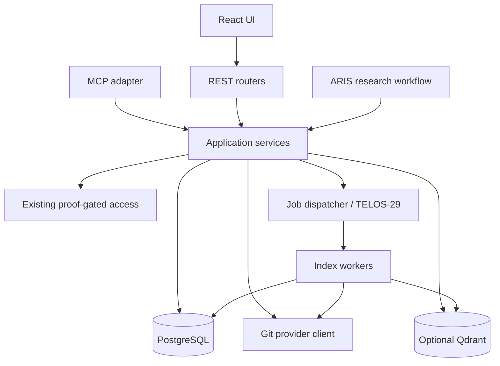

# TELOS SPACE — Repository Intelligence

**Техническая и продуктовая спецификация · Backend / Frontend / ARIS / MCP**  
Версия 1.0 · 24 ноября 2026 · Проект требований для агента-исполнителя

Визуальное приложение: `TELOS_REPOSITORY_VISUAL_GUIDE.html`. Оно содержит четыре исходных концепта интерфейса. Все цифры, пути и связи на концептах демонстрационные, не факты о репозитории.

## 1. Цель и границы

TELOS SPACE связывает цели, знания, задачи, риски и фактическую реализацию проекта. Repository Intelligence — подсистема внутри проекта, позволяющая человеку и Арису исследовать код, понимать архитектуру, находить доказательства реализации требований и анализировать изменения. Это не IDE, не замена GitHub и не автономный редактор кода. Работа с исходниками в рамках данной спецификации — только чтение. Настройка подключения и запуск индексации — отдельные управляемые операции.

Сценарии: найти реализацию бизнес-операции; проследить путь от API до БД; открыть точный исходник; понять зависимости; сравнить версии; исследовать влияние изменения; проверить соответствие архитектурному стандарту; связать задачи с доказанными изменениями; получить ответ Ариса со ссылками. Нельзя считать наличие кода доказательством работоспособности или завершения задачи.

## 2. Исходное состояние и обязательства по совместимости

По предоставленному отчёту разработчика (не независимому аудиту): локальный версионный индекс/FTS и bounded-карта находятся на стадии тестирования. Реализованы отдельные snapshots/checkpoints/manifests по repo/SHA/политике, фильтрация секретов/бинарников/шума, source range/hash, проверка трёх репозиториев в realPG без коллизий. Карта ограничена 100 components/500 relations. Python AST — declared; JS/TS lexical — candidate/partial. Raw Git недоступен через generic SQL-каталог; proof-gated adapter проверяет текущий внешний доступ. Chrome desktop/mobile smoke проверил три источника и exact source read; полный live индекс не проверен, прочитан один файл, coverage partial. Переиндексация изменений запускается при переходе задачи в «Готово»; предусмотрен общий сервис TELOS-29.

Перед реализацией изучить фактический код, миграции, тесты, контракт TELOS-29, существующие FASTAPI_PATTERNS.md, DESIGN_GUIDE.md, app.css и инструменты MCP. Составить таблицу reuse/extend/new. Не дублировать существующий диспетчер, адаптер доступа, очередь или индекс. Имена ниже — предлагаемые контракты, не утверждение об имеющихся классах. Не менять текущие права и публичные API без совместимой миграции. Не объявлять полную готовность на основании smoke.

## 3. Архитектура

FastAPI async, лёгкий router → класс service → классы repository/client. Доменная логика и авторизация общие для UI, REST, MCP и Ариса. PostgreSQL — источник истины для метаданных и графа; Git/provider — источник исходников; Qdrant (если вводится) — восстанавливаемый поисковый индекс. RabbitMQ/существующая очередь — фоновые работы; Redis только для временного состояния и кэша. Не вводить отдельную графовую БД без измеренной необходимости.



Предлагаемые сервисы: RepositoryConnectionService (подключения), SnapshotService (версии), IndexJobService (оркестрация), CodeExtractionService (парсинг), SymbolResolutionService (разрешение), GraphService (связи и агрегация), CodeSearchService (retrieval), SourceReadService (точное чтение), ChangeImpactService (diff/impact), CodeResearchService (ограниченное исследование). Репозитории отвечают за SQL, транзакции и пагинацию; клиенты — за Git provider, embeddings, rerank, LLM. Парсеры — чистые адаптеры без сетевого доступа. CPU-heavy разбор выполнять в worker/process pool, не блокировать event loop. LLM client использовать по корпоративному стандарту с timeout, retry для временных ошибок, лимитами и структурированным результатом.

## 4. Модель данных

Использовать существующие таблицы там, где они покрывают контракт. UUID/внутренние идентификаторы по стандарту проекта, UTC timestamps, FK внутри домена, миграции Alembic. Все ссылки на исходник включают repo и immutable SHA. Внешний ID репозитория не заменять его именем.

| Сущность | Основные поля и ограничения |
|---|---|
| repository_connection | id, project_id, provider, external_repo_id, ref, credential_ref, policy_id, state; уникальность подключения в проекте по согласованной политике |
| index_snapshot | id, repo_id, commit_sha, policy_hash, extractor_version, state, manifest_hash, coverage, created_at, published_at; unique(repo_id, commit_sha, policy_hash, extractor_version) |
| index_job | id, snapshot_id, base_snapshot_id, trigger, idempotency_key, state, checkpoint, attempts, heartbeat_at, error_code |
| file_revision | id, repo_id, path, blob_sha, content_hash, language, size, line_count, parse_status, exclusion_reason |
| snapshot_file | snapshot_id, file_revision_id, path; unique(snapshot_id,path); неизменяемый manifest |
| code_symbol | id, file_revision_id, kind, qualified_name, signature, parent_id, start_line, end_line, byte_range, docstring, parser_version, symbol_key |
| code_chunk | id, file_revision_id, symbol_id nullable, range, hash, kind, token_count |
| code_relation | snapshot_id, source_symbol/component, target_symbol/component nullable, unresolved_target, kind, evidence_range, resolver, evidence_level |
| component | snapshot_id, component_key, parent_key, kind, label, path_prefix, origin, evidence_refs |
| semantic_annotation | target_id, content_hash, model_id, prompt_version, summary, evidence_refs, state |
| task_code_link | task_id, repo_id, commit_sha, path/symbol optional, provenance, verified_at, actor_id |
| search_index_state | snapshot_id, index_type, generation, model_version, state, coverage |

Повторно использовать неизменённые file_revision/symbol/chunk между snapshots при совпадении содержимого и версии экстрактора. Разрешённые связи зависят от snapshot, а не только blob: изменение импортируемого файла может менять разрешение в неизменённом файле. Не использовать глобальный hash как ключ доступа. Индексы: repo/ref, snapshot/path, qualified_name, normalized symbol, GIN FTS, trigram, adjacency source/target, task/repo/SHA. Удаление старых snapshots по retention с учётом ссылок на задачи и аудита; GC только после проверки ссылок.

## 5. Pipeline индексации

1. Проверить доступ, получить неизменяемый head SHA для выбранного ref, зафиксировать policy и версии экстракторов. Не читать moving branch в середине job.
2. Создать idempotent job. Сериализовать публикацию для одного подключения, разрешить параллельность разных репозиториев. При повторном событии coalesce одинаковых SHA; старый job не должен заменить более новый head.
3. Получить manifest через provider с пагинацией и checkpoint. Если base доступен и совместим, получить diff; при force-push, смене политики или отсутствии base выполнить reconciliation/full scan. Обрабатывать добавления, удаления, переименования и изменения.
4. До сохранения текста и передачи модели применить path/size/type фильтры и secret scanning. Исключить .env, ключи, credentials, бинарники, vendor/node_modules, generated/minified, build, lock-файлы по политике. Не следовать symlink за границы repo, submodule — отдельное разрешённое подключение. Не исполнять код, сборку или package scripts.
5. Читать blob по SHA, ограничивать размер/время, сохранять hash и диапазоны. Извлечь символы, чанки, FTS. Ошибки парсинга не скрывать: fallback текстовый с partial status.
6. Переразрешить затронутые зависимости, включая входящие ссылки и конфигурацию import paths. Инвалидировать агрегаты, summaries и embeddings затронутых компонентов. Для больших fan-out — отдельный bounded job с явным partial coverage.
7. Построить manifest, проверить целостность. Публиковать snapshot атомарно только после обязательных стадий. Дополнительные индексы имеют собственную готовность; поиск не должен смешивать поколения. Сохранять предыдущую пригодную версию при сбое, явно показывать stale.
8. Обновить статус и отправить событие через существующий механизм/outbox. Retry с backoff/jitter, dead-letter, heartbeat/lease, восстановление по checkpoint. Отмена не публикует незавершённый индекс.

Триггеры: ручной, webhook Git (проверка подписи и replay), периодическая сверка, завершение задачи. Завершение задачи не должно блокироваться ожиданием индекса; повторный запуск при неизменном SHA — no-op. Индексировать только разрешённые refs. Связь изменения с задачей не выводить из времени запуска.

### 5.1. Охват

Возвращать отдельно total manifest, eligible, excluded (по причинам), fetched, parsed, searchable, embedded, failed, pending, graph truncation. Если total неизвестен, не рисовать процент. Показывать observed head, indexed SHA, время последней проверки, состояние stale/partial/failed/ready. Полнота FTS не означает полноту графа. Лимиты 100/500 сохранять как начальные лимиты выдачи карты, не как скрытое ограничение полного индекса.

## 6. Структурный анализ и чанкинг

Python AST: функции, async, классы, методы, декораторы, импорты, сигнатуры, аннотации, docstrings. AST подтверждает наличие декларации, но не разрешённый runtime вызов. JS/TS: заменить/дополнить lexical Tree-sitter; для точного разрешения импортов, aliases и типов — TypeScript Compiler API в изолированном анализаторе без исполнения проекта. Rust и другие языки подключать через интерфейс LanguageExtractor. Конфиги, Markdown, SQL, Dockerfile, YAML индексировать структурно по секциям; не выдавать предположение из имени файла за роль компонента.

Основная единица — символ; небольшая функция целиком, большой класс — отдельные методы плюс заголовок класса; длинный метод — диапазоны по AST statements с ограниченным перекрытием. Начальные настройки 400–1000 токенов, максимум 1600, настраиваемые и проверяемые eval. Сигнатура, путь, родитель и релевантные imports добавляются как контекст, но не выдаются за строки исходника. Markdown с кодом: заголовок секции, prose и fenced code сохранять раздельно и связывать. Для fallback использовать line-aware chunks. Нумерация строк 1-based inclusive; byte ranges — отдельно, с определённой кодировкой. Проверять точность диапазона на CRLF и Unicode.

Пример контракта (условные данные):
```json
{"repo_id":"r1","commit_sha":"abc123","path":"backend/src/services/task_service.py","qualified_name":"TaskService.create_task","kind":"method","language":"python","signature":"async def create_task(self, data: TaskCreate)","start_line":42,"end_line":78,"evidence_level":"declared","content_hash":"..."}
```

## 7. Граф архитектуры

Узлы: repository, directory, component, file, symbol, external dependency, endpoint, datastore (только при наличии доказательства). Рёбра: CONTAINS, IMPORTS, CALLS, INHERITS, IMPLEMENTS, TESTS, EXPOSES, PUBLISHES, SUBSCRIBES, DEPENDS_ON. Различать containment и dependency. Направление dependency — потребитель → зависимость. У каждого ребра source range, resolver/version, evidence level: declared (синтаксис), resolved (статически разрешено), candidate (неоднозначно), inferred (LLM), unresolved. Не рисовать все как одинаково достоверные. Динамические вызовы могут быть неизвестны; отсутствие ребра не доказывает отсутствие зависимости.

Группировка по папкам и подтверждённым конфигурациям; архитектурные роли — из явных правил проекта либо маркированной классификации. Поддержать слои router/service/repository/client для FastAPI, но не навязывать их любому репозиторию. Агрегировать связи между компонентами с count и drill-down до доказательства. Ограничить depth 1–3 по умолчанию, visited set для циклов, max nodes/edges, cursor и truncation reason. Использовать SQL adjacency и recursive CTE с лимитами. Не выполнять полный графовый обход на HTTP request.

## 8. Поиск

Параллельные retrieval каналы после авторизации и фиксации snapshot: exact path/symbol, prefix/trigram (camelCase/snake_case токенизация), PostgreSQL FTS (отдельные поля кода с simple config и русскоязычного prose), optional dense embeddings (Qdrant), graph expansion. Для точного имени приоритет exact, для смыслового вопроса — гибрид. Фильтры repo, SHA, language, layer, path, symbol kind, evidence level. Индексировать оригинальные идентификаторы и нормализованные варианты. Не стеммить имена функций как естественный язык.

Начальный алгоритм: 30–50 кандидатов на канал; RRF с k=60 как стартовая настройка; дедуп по repo/SHA/range; exact boost; rerank top 20–30; вернуть top 10–15 с причинами совпадения. Graph expansion только от релевантных seeds, 1–2 hops, отдельный бюджет. Настройки уточнять на eval. Для точного поиска не требовать LLM. При недоступности Qdrant/reranker использовать FTS/symbol fallback и обозначить режим. Векторный индекс хранит минимальный payload, идентификаторы и версию; при выдаче повторно проверять доступ и актуальность. Не смешивать несовместимые embedding models. Не вводить Qdrant до baseline оценки текущего поиска.

LLM enrichment: summary файла/модуля, responsibilities, entry points, domain entities, architecture role, evidence refs. Кэш по hash/model/prompt version, обновление при изменении контекста. Сначала deterministic index, затем optional enrichment. Модель не устанавливает статус риска или успешность тестов без подтверждённых данных. Код и документация — недоверенные данные, не инструкции для агента.

## 9. ARIS: исследовательский workflow

Вход: вопрос, project_id, разрешённые repos, pinned snapshots, conversation_id. Детерминированный оркестратор задаёт бюджет и разрешённые read-only инструменты. LLM выбирает следующий запрос, не исполняет shell и не меняет данные. Цикл: определить намерение → карта/поиск → прочитать точные диапазоны → расширить по зависимостям → проверить доказательства → ответ или уточнение. Начальный бюджет: 6 итераций, 20 tool calls, 60 секунд, 24k токенов контекста (настраиваемые). Не повторять одинаковые запросы, поддерживать отмену, возвращать partial answer при исчерпании бюджета.

Ответ: краткий вывод, объяснение цепочки, ссылки repo/path/SHA/lines, ограничения охвата, отдельно гипотезы. Проверять существование citation и соответствие snapshot программно. При отсутствии доказательств говорить «не найдено в доступном индексе», не «не реализовано». Для вопросов о соответствии паттернам читать и стандарт, и код. Не отправлять запрещённые исходники внешней модели; политика провайдера и tenant-level allowlist обязательны. При смене прав остановить исследование и не выдавать ранее извлечённый закрытый контекст.

## 10. REST API и MCP

Предлагаемые REST пути под существующим `/api/v1/projects/{project_key}`; адаптировать к текущим контрактам. Все GET пагинируются, ошибки структурированы, ответы включают snapshot/coverage. Не передавать credentials клиенту.

| Метод и путь | Назначение |
|---|---|
| GET /repositories | подключения и состояние |
| POST /repositories | подключить (write scope) |
| GET /repositories/{id}/snapshots | версии |
| POST /repositories/{id}/index-jobs | запуск, 202 + job_id, idempotency key |
| GET /repositories/{id}/index-jobs/{job_id} | прогресс |
| GET /repositories/{id}/tree | parent path, snapshot, cursor |
| GET /repositories/{id}/source | path, SHA, start/end, exact read |
| GET /repositories/{id}/symbols | symbol/path фильтры |
| GET /repositories/{id}/graph | root, depth, limits, mode |
| GET /repositories/{id}/relations | symbol, direction, kinds |
| POST /code/search | query, repos, snapshots, filters, limit |
| GET /repositories/{id}/changes | base/head SHA, path, cursor |
| GET /repositories/{id}/coverage | охват и ограничения |
| POST /code/research | запуск исследования, 202 + receipt |

MCP через существующий Streamable HTTP и общие сервисы, без отдельного доступа к БД. Имена проверить по каталогу, расширять без дублирования: `telos_get_repository_map`, `telos_search_code`, `telos_find_symbol`, `telos_read_symbol`, `telos_read_file`, `telos_get_module_context`, `telos_find_references`, `telos_get_dependencies`, `telos_get_dependents`, `telos_get_code_changes`, `telos_get_index_coverage`. Входы — project_key, repo_id, SHA/snapshot, bounded range/limit. Выходы — structuredContent, source refs, coverage, next_cursor, warnings. Read-only инструменты не запускают индексацию скрытно. Существующие telos_ask_aris/telos_get_aris_result использовать для исследовательского сценария, если подходят. Scopes и proof-gated adapter одинаковы для UI/API/MCP; confirmation не расширяет права.

## 11. Безопасность и эксплуатация

Проверять проектные права и текущий внешний доступ перед поиском, выдачей metadata, графом, raw read и повторным чтением сохранённых результатов. Кэш partitioned по principal/repo/snapshot/policy, короткий TTL, отзыв доступа инвалидирует выдачу. Не позволять generic SQL, экспортам, логам, embeddings или summaries обходить ACL. Секреты в vault/существующем secret storage; provider credentials минимальных read scopes. SSRF: разрешённые провайдеры, проверка redirects/DNS, запрет внутренних адресов при произвольных URL. Ограничить архивы, размеры, декомпрессию и concurrency. Markdown и код выводить безопасно, без исполнения HTML/JS. Логи без raw source и токенов. Аудит actor/action/repo/SHA/outcome. Метрики job duration, queue lag, files/sec, failures, coverage, retrieval latency, LLM cost, access denials. Trace request/job/research IDs. Retention и удаление подключения должны учитывать производные индексы и кэши.

## 12. Frontend — самостоятельное рабочее пространство «Код»

React/TypeScript, существующие компоненты, маршрутизация и query cache. Настройки проекта оставляют подключение, политику и технический статус; длинный каталог переносится в вкладку «Код». Вкладки внутри: Обзор/Файлы, Архитектура, Изменения, Поиск; зависимости — режим архитектуры. Не добавлять вымышленные разделы и метрики. Один общий выбранный repo/ref/snapshot, синхронизация дерева, карты и панели деталей. URL хранит repo, snapshot, view, path/symbol, range; не хранит секреты. Поддержать back/forward и deep links.

### 12.1. Композиция и дизайн

Визуальное приложение содержит четыре концепта: браузер файлов, иерархическая карта, радиальная карта, слоистая архитектура. Использовать их как варианты одного workspace, не четыре независимых приложения. Основной режим — слоистая/иерархическая карта; радиальная — дополнительный режим для исследования связей. Сохранять исходный нейтральный графитовый фон, не переносить синий оттенок фона из концептов. Палитра из BRAND_BRIEF: #181818 / #1F1F1F / #252526 / #2B2B2B, border #3C3C3C, text #E8E8E8 / #CCCCCC, blue #0078D4 / #4DAAFC, AI #9B8CFF. Семантические цвета из существующего theme. Inter, JetBrains Mono для кода. Отступы 8/12/16/24, radius 8–12, border 1px, умеренная подсветка только выбранного узла. Без портрета Ариса, декоративных волн и сильного неона. Иконки из текущей библиотеки.

Desktop: существующий sidebar, верхняя строка проекта и вкладок, toolbar repo/ref/SHA/coverage; внутри grid: дерево 240–280px, canvas minmax(0,1fr), inspector 320–380px. Разделители изменяемой ширины с клавиатуры; панели сворачиваемые. При 1280px inspector допускается drawer; при <900px один активный pane, переключатель Файлы/Карта/Детали; никакого горизонтального overflow страницы. Код и canvas могут иметь собственный scroll. Не делать огромную шапку; toolbar 48–64px, рабочая зона занимает остаток viewport.

### 12.2. Браузер файлов

Lazy tree (React Arborist либо текущий accessible tree), поиск по пути, иконки языка, breadcrumbs, каталог с пагинацией, выделение выбранного файла. Monaco read-only с номерами строк, подсветкой синтаксиса, переходом к диапазону, копированием, открытием точной версии у Git-провайдера. Для больших файлов — range read и лимит; для бинарных/исключённых — объяснение, не пустой редактор. Markdown безопасно рендерить отдельно. История и diff только если provider/индекс предоставляют данные. Статус индексации и источник видны рядом с кодом.

### 12.3. Карта архитектуры

React Flow (@xyflow/react), ELK.js для layered layout; радиальный layout как отдельная стратегия. Layout в worker для тяжёлых графов. Node card: icon, label, role/path, count, status, evidence; min width 150–200px, высота 56–80px. Слои — горизонтальные контейнеры с заголовком и группами узлов. Связи тонкие, стрелки направления, candidate/inferred пунктиром и текстовой легендой. Selected node — синяя/фиолетовая рамка, соседние связи выделены, остальные приглушены. Цвет не единственный носитель смысла. Canvas — нейтральный #181818 с редкой точечной сеткой. Toolbar: depth, mode, fit, zoom +/- , fullscreen, reset, filters. Drill-down по двойному клику или кнопке «Раскрыть», одиночный выбор открывает inspector. Не рисовать тысячи файлов одновременно; агрегировать и показывать «ещё N», запрашивать следующую область. Сохранять позиции/zoom при переключении overlays, не прыгать при каждом refresh.

Радиальная карта: центральный repo, группы компонентов вокруг, файлы раскрываются по запросу. Размер узла может кодировать число файлов только при явной легенде. Не рисовать декоративные связи. Слоистая карта: router → service → repository/client, только если роли подтверждены; произвольные проекты — собственные слои/группы. Иерархия файлов и зависимости визуально различаются.

### 12.4. Inspector и overlays

Панель справа: назначение (источник/LLM маркировка), путь, версия, язык, coverage, входящие/исходящие зависимости, исходник, связанные задачи, изменения, риски. Каждая связь раскрывает evidence. Overlays «Структура», «Изменения», «Риски», «Зависимости» меняют подсветку, не структуру карты. Риск показывать только из реестра или явно маркированной гипотезы. Изменения — diff base/head, added/modified/deleted/renamed, +/- строки при наличии. Связанные задачи — только verified или явно manual/candidate. Не показывать успешные тесты без результата CI.

### 12.5. Поиск и Арис

Поиск с debounce, отменой старых запросов, фильтрами и группировкой по repo/path. Результат: symbol, snippet, строки, SHA, причина совпадения, evidence, кнопки «Открыть»/«На карте». Арис — компактная кнопка «Спросить о компоненте» и боковая панель исследования, без крупного аватара. Передавать выбранный контекст как идентификаторы, не доверять raw тексту клиента. Показывать этапы поиска, источники, отмену, partial/stale. Клик по citation открывает точный диапазон. Не менять задачи автоматически.

### 12.6. Состояния и доступность

Loading skeleton, empty repository, no access, disconnected, indexing, partial, stale, failed, no results, unsupported language, deleted file, missing snapshot. Ошибка локальна для панели; сохранять предыдущие данные с маркировкой. Polling job с backoff либо существующий SSE; не блокировать UI. WCAG 2.2 AA: контраст текста 4.5:1, controls 3:1, visible focus, reduced motion. NVDA: дерево с корректной клавиатурной навигацией, aria-expanded, названия кнопок; альтернативная табличная карта с теми же узлами и связями, доступная без canvas; код доступен в plain-text режиме. Live regions для статуса, без озвучивания каждого процента. Проверить zoom 200%, Tab/Shift+Tab, Enter/Escape, отсутствие keyboard traps.

## 13. Связь задач, знаний и кода

Хранить явные ссылки на commits/PR из интеграции или ручного действия, provenance и проверку принадлежности репозиторию. Не считать все изменения между двумя индексациями результатом одной задачи. Diff привязан к base/head; merge commits и force-push требуют явной обработки. Impact analysis — список потенциально затронутых зависимых компонентов с evidence и ограничениями. Арис сопоставляет требования, документы и код, но не объявляет выполнение критерия без доказательства. Ссылки на старые версии остаются воспроизводимыми в пределах retention и текущих прав.

## 14. Тестирование и измерение качества

Unit: AST ranges, Unicode/CRLF, symbol resolution, фильтры, RRF, graph cycles, access policy. Integration realPG: три repo с одинаковыми путями/символами, миграции, rollback, атомарная публикация, race двух jobs, удаление/rename/force-push, изменение политики, отзыв доступа, восстановление checkpoint, outbox duplicate. Provider tests: pagination, rate limit, timeout, invalid webhook, symlink, oversized blob. Security: secret fixture не попадает в SQL/FTS/Qdrant/log/LLM; запрещённый repo не виден через graph/count/cache/MCP; prompt injection в README не меняет поведение. Live smoke: разрешённый тестовый GitHub repo целиком, сравнить manifest и exact source, повторить incremental diff; не использовать production secrets.

Eval: 50–100 реальных вопросов по Python/TS и нескольким repo, эталонные символы/строки и negative questions. Сравнить baseline FTS, symbol+FTS, graph expansion, dense/rerank. Recall@10, MRR, citation validity, supported answer rate, abstention accuracy, latency/cost. Начальные цели для согласования после baseline: Recall@10 ≥85% на размеченных вопросах, 100% валидных source refs, ноль утечек, p95 обычного поиска ≤2s на согласованном тестовом объёме. Не считать цели измеренными результатами. Отдельно оценить partial coverage и неоднозначные имена.

Frontend: Playwright desktop 1440/1280, mobile 390, zoom 200%, NVDA вручную; tree → node → source → task → back; переключение repo/SHA, stale/partial, ошибки, клавиатура, отсутствие page overflow. Screenshot comparison с HTML-референсами по композиции и токенам, а не по вымышленным данным. Нагрузочный тест карты 100 nodes/500 edges, ограничение выдачи и стабильность layout.

## 15. План реализации и gates

| Этап | Результат и gate |
|---|---|
| 0. Аудит | карта текущих классов, контракт TELOS-29, baseline eval, план совместимых миграций |
| 1. Надёжность индекса | full live smoke, incremental/delete/rename, manifest/coverage, ACL regression |
| 2. Symbol index | Python AST расширен, TS parser, точные ranges, fallback |
| 3. Graph | typed edges, resolution, invalidation, bounded API, доказательства |
| 4. Retrieval | symbol+FTS+RRF, eval; Qdrant/rerank только при обоснованном улучшении |
| 5. Workspace UI | файловый браузер, код, inspector, coverage, доступность |
| 6. Architecture UI | layered/hierarchical/radial modes, overlays, drill-down, visual regression |
| 7. ARIS/MCP | bounded research, citations, общие ACL, read-only tools, eval |
| 8. Impact | task/commit links, diff, knowledge comparison, эксплуатационные метрики |

Этапы 2–5 допускают параллельную работу после согласования контрактов. Каждый этап заканчивается тестами, документацией, миграцией и отчётом с фактическим охватом. Feature flags для новых режимов; rollback сохраняет старый индекс и текущие API. Не включать destructive migration без backup и проверки восстановления.

## 16. Definition of Done

- Текущая индексация не сломана, все новые сущности версионированы и мигрируют.
- Поиск и граф не смешивают репозитории, SHA или права; exact source воспроизводим.
- Full/incremental индексация проверена на реальном разрешённом репозитории, ошибки и partial видны.
- UI содержит четыре представления из визуального приложения, использует реальные данные и корпоративные токены, не портрет Ариса.
- MCP и Арис используют единый сервисный слой, цитируют код и честно сообщают ограничения.
- Есть измеримый eval, security regression, desktop/mobile/NVDA acceptance и runbook для восстановления jobs.

## 17. Справочные технические ресурсы

Рекомендуемые официальные документации для проверки совместимости версий при реализации: [Python AST](https://docs.python.org/3/library/ast.html), [Tree-sitter](https://tree-sitter.github.io/tree-sitter/), [TypeScript Compiler API](https://github.com/microsoft/TypeScript/wiki/Using-the-Compiler-API), [PostgreSQL FTS](https://www.postgresql.org/docs/current/textsearch.html), [Qdrant](https://qdrant.tech/documentation/), [React Flow](https://reactflow.dev/), [ELK.js](https://github.com/kieler/elkjs), [Monaco](https://microsoft.github.io/monaco-editor/), [MCP](https://modelcontextprotocol.io/). Версии и наличие библиотек проверяет агент по lock-файлам и официальной документации; данная спецификация не утверждает их текущую установку.
